# ECOCIDE — Architecture

Three views of the same system. **§1** and **§3** are one-screen overviews for
orientation. **§2** is the runtime shape in detail: what happens between a photo
and a verdict, down to the modules. **§4** is the GCP deployment: what is
provisioned, what talks to what, and who is allowed to do it.

Sources live beside the rendered files as Mermaid (`.mmd`) — an SVG is a build
artifact, so the source has to survive the render (see [Regenerating](#regenerating)).

## 1. Technical architecture (overview)



The whole system at a glance:

- A **single application server** serves the API and the app itself, so the
  browser talks to one origin.
- A scan is a **two-pass pipeline**: the AI reads the photo, then the
  **deterministic compliance engine** — not the model — scores it, then the AI
  writes the verdict text.
- **Lore** (all copy, prompts and art) is a separate pack, and it also carries
  the **offline fallback**: with no AI credentials the pipeline still produces a
  complete audit instead of failing.
- State is a **database** plus the **evidence photos** kept as files.

## 2. Technical architecture (detail)



Read it top-down:

- **Client** (`apps/web`, React 19 + Vite + Tailwind v4) is a PWA. It renders the
  SPA routes and the dossier components, and it holds no detection logic. The
  interesting libs are the canvas audit lenses, the PNG export
  (`dossier-export.ts` rasterises the *same* dossier sheet the page renders), the
  session hook (`useVault`, gated on `sessionReady`, never better-auth's
  `isPending`) and the API client.
- **Server** (`apps/server`, Hono) serves the built SPA and `/api/*` from one
  origin, which is what lets auth be a plain `session_token` cookie. The centre of
  the diagram is the **two-pass pipeline**: vision inventory → deterministic
  compliance math → text classification. The math sits *between* the two model
  calls, so the model never touches it.
- **Packages** are the two hard rules made physical: `@ecocide/lore` owns every
  story string and the prompt builders, `@ecocide/compliance` owns the formula,
  and `@ecocide/types` wires them into contracts (including the tariff and payout
  schedule in `economy.ts`). Components and the server only import.
- **State**: PostgreSQL via Drizzle — `pg` in production, PGlite in-process
  locally, one schema and one repository implementation for both. Audit photos are
  *files* referenced by `evidence_filename`, never DB blobs. Redis only exists in
  dev; with no `REDIS_URL` the job dispatcher runs handlers inline.

**The offline path is a first-class branch**, not a test stub: with no
`GEMINI_*` credentials the pipeline falls back to `lore/simulate.ts`, which
generates a deterministic archetype room, inventory and verdict. `pnpm test`, the
`/debug` bench and local development therefore cost nothing and need no network.

## 3. GCP infrastructure (overview)



Two planes, and it is worth reading them separately:

- **Runtime** — users reach a Cloud Run service through a managed HTTPS
  certificate. That one container serves the API and the app, and reaches its
  database, its evidence bucket, its secrets, its AI provider and its email relay.
  It scales to zero, so the database is the only always-on cost.
- **Delivery** — GitHub Actions builds the image, runs migrations and deploys.
  It is **keyless**: there are no service-account JSON keys anywhere in the
  repo or in CI.

One thing the overview deliberately leaves out, because drawing it makes the
picture unreadable: **every runtime permission lives on a single service account**
(Vertex AI, database, secrets, bucket). That identity is what the app *is* in
production — drop the `--service-account` flag and Cloud Run silently falls back to
the default compute account, which has none of those permissions. The detailed
diagram and the release notes below cover it.

## 4. GCP infrastructure (detail)



The production shape is deliberately flat — **no Kubernetes**, one container:

| Piece | Role |
| --- | --- |
| Cloud Run service `ecocide` | API + built SPA, `:3000`, scales to zero, 0–3 instances, `--no-cpu-throttling`, gen2 |
| Cloud SQL `ecocide-pg` | PostgreSQL over a unix socket; Enterprise edition on `db-f1-micro`, backups + PITR |
| GCS evidence bucket | Volume-mounted at `/app/evidence` via FUSE; write-once audit photos |
| Secret Manager | `ecocide-db-url`, `ecocide-auth-secret`, `ecocide-smtp-pass` injected as env |
| Vertex AI | Gemini via ADC on the runtime service account — no API key in the image |
| Artifact Registry | Holds the images; the service and the migrate job both pull from it |
| Cloud Run job `ecocide-migrate` | Runs `dist/migrate-cli.js` once per release, before the traffic shift |
| Workload Identity Federation | GitHub Actions gets short-lived tokens; there are no static keys |

Every runtime permission lives on the `ecocide-run@` service account
(`aiplatform.user`, `cloudsql.client`, `secretmanager.secretAccessor`, log and
metric writers, `storage.objectAdmin`). The deployer identity holds only what a
release needs. **Omit `--service-account` and Cloud Run silently falls back to the
Compute Engine default account**, which has none of these — the failure mode is
either a hard "permission denied on secret" or, worse, a *quiet* drop into offline
simulation because `aiplatform.user` is missing.

### Release sequence

`.github/workflows/deploy-gcp.yml`, on a `v*` tag push:

1. **verify** — `pnpm build && pnpm test` (hermetic; DB tests boot PGlite in memory).
2. **build & push** the image to Artifact Registry.
3. **migrate** — repoint the `ecocide-migrate` job at the new tag, then execute it.
   Migrations ship inside the image, so the job must be re-pointed or production
   would be migrated by the *old* code. They run before the traffic shift, so they
   must stay additive.
4. **deploy a revision with no traffic** (`--no-traffic --tag=candidate`).
5. **smoke-test** `/api/health` on the candidate URL — asserts `PostgreSQL Active`,
   an engine starting with `Vertex AI` (this is what catches the silent fallback),
   and a mailer that is not in a failing state.
6. **shift traffic.** A failed smoke test leaves the previous revision serving.

Rollback is a `workflow_dispatch` run with the previous `image_tag`, or
`gcloud run services update-traffic`. Rolling the app back does **not** roll the
schema back — hence the additive-only rule.

## Block colours

Mermaid paints every `subgraph` with one `clusterBkg` (a pale yellow), so per-block
colour comes from a `classDef` applied to each block id. The four `.mmd` sources share
one palette, and the colours carry meaning across all of them:

| Role | Colour | Used by |
| --- | --- | --- |
| `uiBlock` | blue `#e3f0fa` | Client, Users — anything user-facing |
| `logicBlock` | mint `#e4f6ec` | Application server, Cloud Run service — compute |
| `dataBlock` | peach `#fdeee0` | Storage, Managed state — persisted state |
| `deliveryBlock` | rose `#fde8ee` | Delivery, migration job, background jobs |
| `metaBlock` | sand `#f6f0dc` | Packages, Identities — code and credentials |
| `cloudBlock` | grey `#f7f8fa` | The outer project container only |

Two rules if you add or recolour a block:

1. **Avoid colours near `#ECECFF`.** That is the default node fill, so a lavender-ish
   block swallows the nodes sitting in it — the first cut of this palette used indigo
   for `Client` and the node inside it disappeared.
2. **Outer containers stay neutral.** `GCP project` is grey so the blocks nested inside
   it read against it; a saturated outer block flattens everything within.

## Regenerating

```bash
cd docs/architecture
./render.sh                    # every diagram
./render.sh gcp-infrastructure # one diagram, name without .mmd
```

`render.sh` runs `mermaid-cli` with `mermaid-config.json` and `diagram.css`, then
`patch-svg.mjs`. All three are load-bearing, and they exist because of traps that
produce an SVG which looks right in one renderer and wrong everywhere else.

- `htmlLabels: false` (**top-level**, in `mermaid-config.json`) makes Mermaid emit
  native `<text>/<tspan>` labels instead of HTML inside `<foreignObject>`.
  Browsers render `foreignObject`; librsvg (GNOME image viewers, ImageMagick),
  Inkscape's SVG import and PDF converters do not — they draw the boxes and
  arrows with **every label silently missing**. Note the per-flowchart
  `flowchart.htmlLabels` key is *not* sufficient: it converts only edge labels,
  leaving node labels in `foreignObject`.
- `patch-svg.mjs` marks the text elements `xml:space="preserve"`. Mermaid emits a
  multi-word label as `<tspan>GitHub</tspan><tspan> Actions</tspan>`, and SVG's
  default whitespace handling says to strip that leading space, so
  spec-compliant renderers draw `GitHubActions`. Chrome is lenient and keeps it.
- `diagram.css` sets the line weights (2px node and block borders, 2.5px edges),
  and `patch-svg.mjs` enlarges the **arrowheads** separately. Those are `<marker>`
  elements sized by `markerWidth`/`markerHeight` attributes — CSS cannot set them —
  and Mermaid emits `markerUnits="userSpaceOnUse"`, so a thicker line does not grow
  the head. Thickening the edge without scaling the marker gives thin lines with
  disproportionately small tips. Note the `-margin` markers are invisible hit areas
  whose inline `stroke-width: 0` must stay 0; a blanket `!important` rule on
  `.arrowMarkerPath` would paint opaque triangles over every arrow tip.

The script fails loudly on either regression (`foreignObject` still present, no
text elements, or Mermaid's "Syntax error" marker — which arrives inside a
*valid* SVG, so a successful exit code proves nothing).

**Verify with a non-browser renderer**, or you are testing the one renderer that
would hide both bugs:

```bash
magick -background white -density 96 gcp-infrastructure.svg /tmp/check.png
```

Transparent background and the default theme, so the SVGs stay legible on both
light and dark README themes — the app's `#080b08` is correct for the product but
unreadable in a light-mode page.

If the CLI's Puppeteer/Chrome download is unavailable, `mermaid.ink` renders the
same sources with no install (`patch-svg.mjs` then still needs to run):

```bash
B64=$(node -e 'console.log(Buffer.from(require("fs").readFileSync("technical-architecture.mmd")).toString("base64url"))')
curl -s "https://mermaid.ink/svg/$B64" -o technical-architecture.svg
node patch-svg.mjs technical-architecture.svg
```
