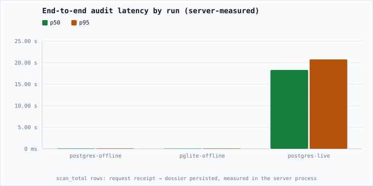
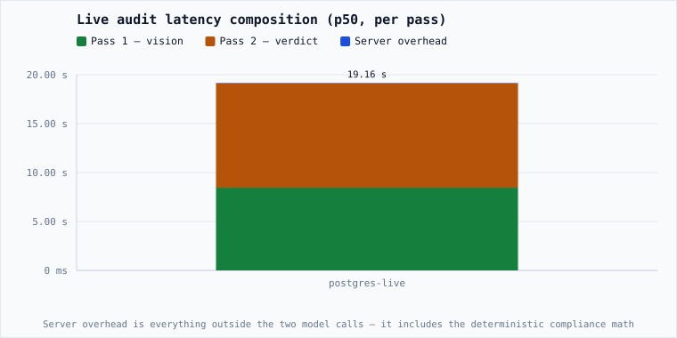
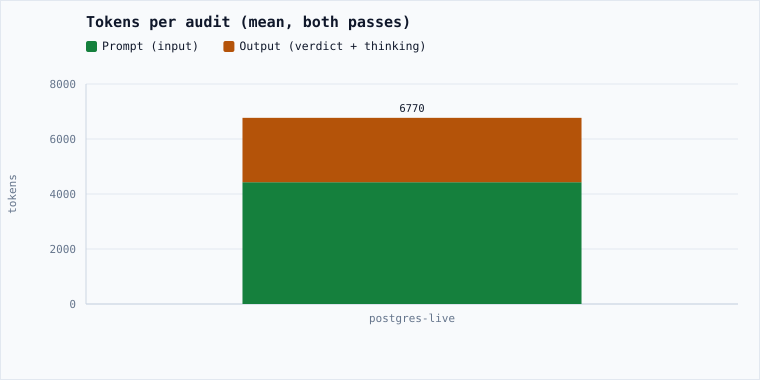
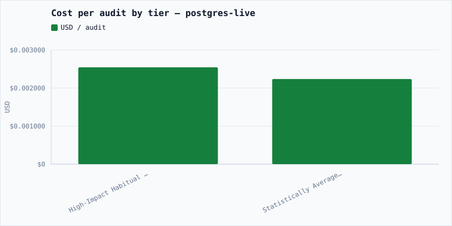
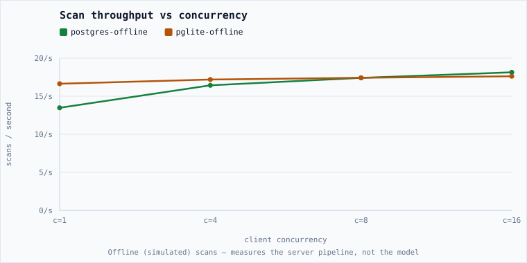
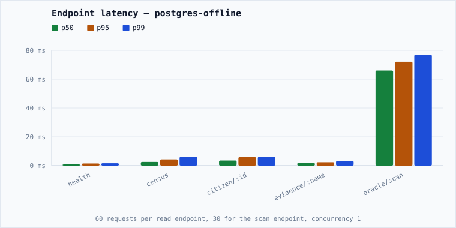

# ECOCIDE — Performance Report

Controlled benchmark of the household-audit pipeline and the API surface, measured by driving a real server process over HTTP.

**Headline (postgres-live):** 18.30 s median end-to-end audit, $0.002482 of tokens per audit (6,770 tokens).

> Regenerate with `pnpm bench` (measure) and `pnpm bench:report` (render). The report is a pure function of the JSON in `docs/performance/data/`.

## 1. Environment

| Property | Value |
| --- | --- |
| Commit | 51ec0607 (uncommitted changes at run time) |
| Generated | 2026-10-17T07:47:36.971Z |
| Node | v24.13.0 |
| Platform | linux 7.2.9-201.fc44.x86_64 (x64) |
| CPU | AMD Ryzen 7 PRO 4750U with Radeon Graphics · 16 cores |
| Memory | 45,865 MB |
| Server build | 2026-10-17T07:28:45.238Z |
| Raw data | docs/performance/data/bench-pglite-offline.json, docs/performance/data/bench-postgres-live.json, docs/performance/data/bench-postgres-offline.json |

## 2. Workload

| Run | Engine | Mode | Model | Scans | Warmup | Concurrency | Corpus | Boot |
| --- | --- | --- | --- | --- | --- | --- | --- | --- |
| postgres-offline | postgres | offline | simulated-engine | 200 | 20 | 1, 4, 8, 16 | synthetic (seeded, 24 generated 640x480 JPEGs) | 1.28 s |
| pglite-offline | pglite | offline | simulated-engine | 200 | 20 | 1, 4, 8, 16 | synthetic (seeded, 24 generated 640x480 JPEGs) | 3.90 s |
| postgres-live | postgres | live | gemini-3.8-flash | 5 | 1 | 1 | real evidence photos: /home/zaro/ai-cup/ecocide/apps/server/data/evidence (8 files ≥ 4096B) | 1.27 s |

## 3. Method

Each run provisions a **throwaway** database (a fresh PGlite directory, or a disposable `postgres:17-alpine` container) and a throwaway evidence directory, starts the real server binary, waits for `/api/health`, then drives load over HTTP.

- **Warmup** scans are discarded before measurement.
- **Per-pass latency** is read back from `scan_api_logs` (the server logs each model call), not inferred from the client.
- **End-to-end latency** comes from the `scan_total` row the scan handler writes: request receipt → dossier persisted.
- **Concurrency** is swept by running the same scan count with a pool of N in-flight requests.
- **Endpoint latency** is measured separately with fixed request counts at concurrency 1.
- **Offline** mode forces `GEMINI_MODE=off`, so the deterministic simulation runs and no tokens are spent; **live** mode uses the configured Gemini engine and is gated behind `--live-confirm=yes`.

## 4. Results

### 4.1 End-to-end latency



| Run | Pass 1 p50 | Pass 1 p95 | Pass 2 p50 | Pass 2 p95 | Overhead p50 | End-to-end p50 | End-to-end p95 | Wall p50 | Errors |
| --- | --- | --- | --- | --- | --- | --- | --- | --- | --- |
| postgres-offline | 1 ms | 1 ms | 1 ms | 1 ms | 64 ms | 66 ms | 84 ms | 74.01 ms | 0 |
| pglite-offline | 1 ms | 1 ms | 1 ms | 1 ms | 55 ms | 57 ms | 75 ms | 59.83 ms | 0 |
| postgres-live | 8.45 s | 10.61 s | 10.67 s | 11.39 s | 45 ms | 18.30 s | 20.76 s | 18.32 s | 0 |

> Offline runs make no model call, so their Pass 1 / Pass 2 columns are the simulation's placeholder (1 ms) — their **End-to-end** and **Overhead** columns are real measurements of the offline pipeline.

### 4.2 Where the live time goes



| Run | Pass 1 (vision) | Pass 2 (verdict) | Server overhead | Share of overhead |
| --- | --- | --- | --- | --- |
| postgres-live | 8.45 s (44%) | 10.67 s (56%) | 45 ms | 0.2% |

> The overhead segment is too small to see next to two multi-second model calls, which is itself the finding: the compliance math, evidence write and persistence are negligible.

### 4.3 Tokens and cost

| Run | Prompt (mean) | Output (mean) | Total (mean) | USD / audit (mean) | USD / audit (p95) | USD total | USD / 1,000 audits |
| --- | --- | --- | --- | --- | --- | --- | --- |
| postgres-offline | 0 | 0 | 0 | $0 | $0 | $0 | $0 |
| pglite-offline | 0 | 0 | 0 | $0 | $0 | $0 | $0 |
| postgres-live | 4,429 | 2,341 | 6,770 | $0.002482 | $0.002873 | $0.0124 | $2.4820 |



Cost is not uniform across the taxonomy — a worse audit carries more objects and more text:



| Tier | Audits | Tokens (mean) | USD / audit (mean) | End-to-end p50 |
| --- | --- | --- | --- | --- |
| High-Impact Habitual Offender | 4 | 6,859 | $0.002544 | 19.17 s |
| Statistically Average Polluter | 1 | 6,414 | $0.002236 | 17.13 s |

### 4.4 Throughput and concurrency



| Run | Concurrency | Scans | Wall (s) | Throughput | p50 | p95 | Errors |
| --- | --- | --- | --- | --- | --- | --- | --- |
| postgres-offline | 1 | 200 | 14.84 | 13.48/s | 74.01 ms | 91.41 ms | 0 |
| postgres-offline | 4 | 200 | 12.18 | 16.43/s | 239.44 ms | 292.92 ms | 0 |
| postgres-offline | 8 | 200 | 11.49 | 17.41/s | 454.23 ms | 576.51 ms | 0 |
| postgres-offline | 16 | 200 | 11.03 | 18.14/s | 879.25 ms | 1.19 s | 0 |
| pglite-offline | 1 | 200 | 12.02 | 16.64/s | 59.83 ms | 78.28 ms | 0 |
| pglite-offline | 4 | 200 | 11.63 | 17.19/s | 275.8 ms | 327.83 ms | 0 |
| pglite-offline | 8 | 200 | 11.48 | 17.42/s | 356.65 ms | 785.2 ms | 0 |
| pglite-offline | 16 | 200 | 11.35 | 17.62/s | 768.6 ms | 1.71 s | 0 |
| postgres-live | 1 | 5 | 89.11 | 0.06/s | 18.32 s | 20.77 s | 0 |

### 4.5 API endpoints



**postgres-offline**

| Endpoint | Requests | p50 | p95 | p99 | req/s | Mean bytes | Errors |
| --- | --- | --- | --- | --- | --- | --- | --- |
| `/api/health` | 60 | 0.82 ms | 1.47 ms | 1.65 ms | 1099 | 190 | 0 |
| `/api/census` | 60 | 2.55 ms | 4.3 ms | 6.08 ms | 331.9 | 406 | 0 |
| `/api/citizen/12peHGe5FK` | 60 | 3.53 ms | 5.92 ms | 6.06 ms | 251 | 5,545 | 0 |
| `/api/evidence/12peHGe5FK.jpg` | 60 | 1.91 ms | 2.34 ms | 3.26 ms | 552.9 | 27,463 | 0 |
| `/api/oracle/scan` | 30 | 66.03 ms | 72.11 ms | 76.97 ms | 15 | 5,349 | 0 |

**pglite-offline**

| Endpoint | Requests | p50 | p95 | p99 | req/s | Mean bytes | Errors |
| --- | --- | --- | --- | --- | --- | --- | --- |
| `/api/health` | 60 | 1.19 ms | 1.56 ms | 1.93 ms | 812 | 186 | 0 |
| `/api/census` | 60 | 2.59 ms | 3.23 ms | 4.43 ms | 372.9 | 406 | 0 |
| `/api/citizen/4gGKvlmJGm` | 60 | 3.27 ms | 4.13 ms | 4.85 ms | 292.9 | 5,545 | 0 |
| `/api/evidence/4gGKvlmJGm.jpg` | 60 | 1.63 ms | 2.23 ms | 2.66 ms | 590.5 | 27,463 | 0 |
| `/api/oracle/scan` | 30 | 51.13 ms | 53.25 ms | 63.03 ms | 19.7 | 5,349 | 0 |

**postgres-live**

| Endpoint | Requests | p50 | p95 | p99 | req/s | Mean bytes | Errors |
| --- | --- | --- | --- | --- | --- | --- | --- |
| `/api/health` | 60 | 2.35 ms | 3.14 ms | 3.77 ms | 422 | 235 | 0 |
| `/api/census` | 60 | 3.45 ms | 4.25 ms | 5.33 ms | 291.5 | 398 | 0 |
| `/api/citizen/B8FP8e2io8` | 60 | 5.86 ms | 6.6 ms | 9.03 ms | 179.3 | 3,632 | 0 |
| `/api/evidence/B8FP8e2io8.jpg` | 60 | 2.28 ms | 4.43 ms | 5.9 ms | 387.6 | 85,839 | 0 |


### 4.6 Compliance math

| Metric | Value |
| --- | --- |
| Household roll-up per call | 3.565 µs |
| Per audited item | 0.2546 µs |
| Items per simulated household | 14 |
| Calls measured | 50,000 |

## 5. Findings

- **postgres-live**: Pass 1 (vision) is 44% of the end-to-end audit and Pass 2 (verdict text) 56%; everything else — request parse, compliance math, evidence write, persistence — is 0.2% (45 ms).
- A real audit costs ~277× the simulated one in latency (18.30 s vs 66 ms) and $0.002482 in tokens; the offline path is free, which is what keeps the test suite and local development hermetic.
- **postgres-offline**: concurrency 1 → 16 multiplies throughput by 1.35× (13.48/s → 18.14/s) while p50 rises 11.88× — the audit is CPU-bound in one Node process, so extra concurrency mostly buys queueing, not parallelism.
- **pglite-offline**: concurrency 1 → 16 multiplies throughput by 1.06× (16.64/s → 17.62/s) while p50 rises 12.85× — the audit is CPU-bound in one Node process, so extra concurrency mostly buys queueing, not parallelism.
- Database driver moves the p50 by 9 ms (postgres 66 ms vs pglite 57 ms) — the storage layer is not the bottleneck; PGlite is fine for local work and the Postgres numbers are the ones to quote.
- The compliance formula runs in 3.565 µs per household (0.2546 µs per item, 14 items) — five orders of magnitude below a single model call, which is why keeping the math out of the model costs nothing and makes the verdict reproducible.
- No failed requests across the measured runs.

## 6. Threats to validity

- **Synthetic corpus (offline).** Offline runs use seeded generated images. That is the point — it makes the workload reproducible — but the simulated pipeline does no image decoding beyond hashing, so offline latency is a floor, not a model estimate.
- **Single Node process.** The audit handler is synchronous CPU work on one thread, so concurrency converts to queueing. These numbers bound one instance; they are not a horizontal-scaling result.
- **PGlite is a lower bound.** In-process PGlite takes a single-process advisory lock, so it cannot be compared to Postgres on throughput; the Postgres run is the production-like one.
- **Disposable Postgres ≠ Cloud SQL.** The container runs on the same machine with no network hop, no connection pooler and no shared-CPU limits. Cloud SQL will be slower than these figures.
- **Live runs carry upstream variance.** Model latency depends on the provider, region (`global` endpoint) and load. Percentiles from a small N are indicative, not a service-level guarantee.
- **Cold start includes migrations.** `boot` time covers process start, database init and schema migration on a fresh database, not a warm restart.
- **Small live sample.** Live scans are bounded deliberately (each one bills real tokens), so p95/p99 from a handful of audits are weakly estimated; treat them as order-of-magnitude.
- **Uncommitted changes at run time.** The recorded commit does not fully describe the code that ran, so these figures are attributable to a working tree, not a release tag.

## 7. Reproduce

```bash
pnpm build                       # the bench spawns apps/server/dist
pnpm bench:matrix                # PGlite + Postgres, offline (free, ~2 min)
pnpm bench --db=postgres --mode=live --live-n=5 --live-confirm=yes   # real tokens
pnpm bench:report                # renders this file and the charts
```

Each run writes one JSON file into `docs/performance/data/`; the report merges every file it finds there, so runs accumulate as the project changes.
